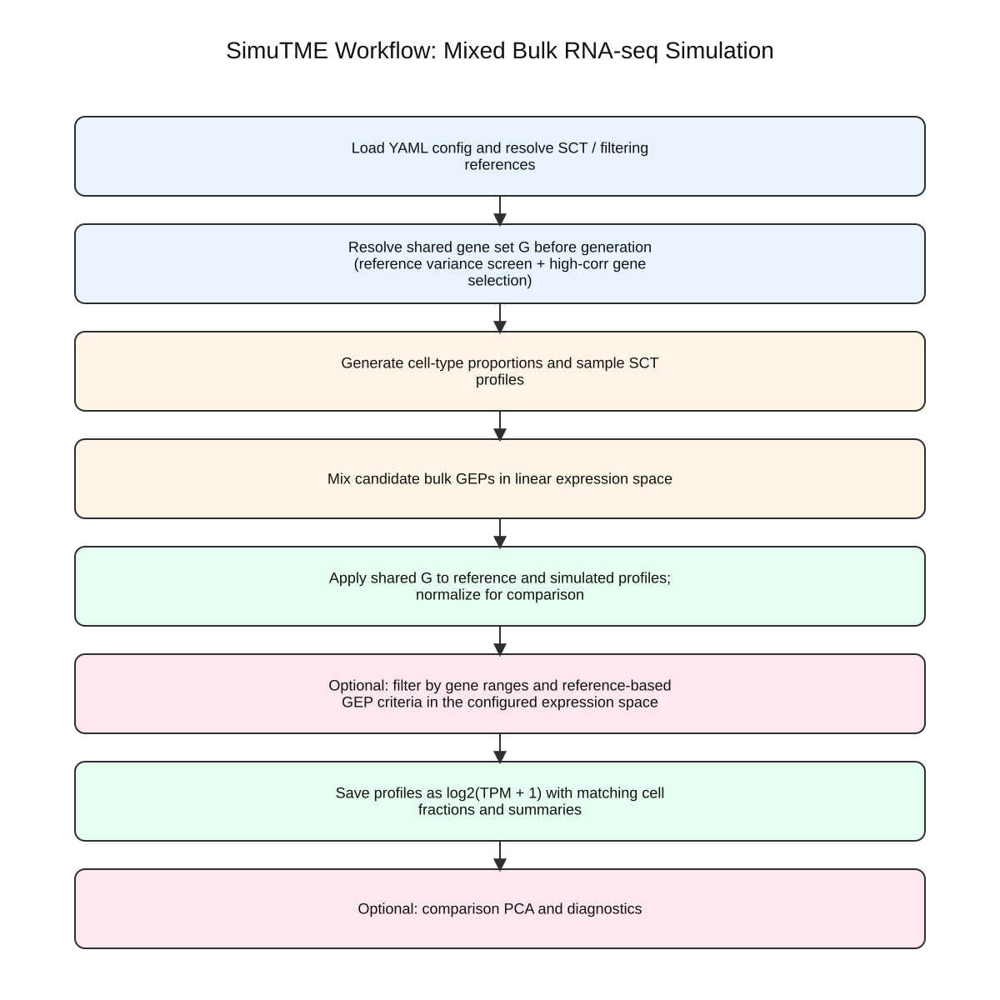

# Mixed Bulk RNA-seq Workflow

## Goal

The Mixed workflow generates synthetic bulk RNA-seq gene expression profiles by
combining cell-type proportions with sampled expression profiles from
single-cell-derived references.

Each generated mixed sample is stored in `log2(TPM+1)` format together with its
ground-truth cell fractions.

## High-Level Steps

1. Load the YAML configuration and dataset-specific parameters.
2. Determine which SCT reference dataset should be used.
3. Initialize `BulkGEPGenerator`.
4. Generate cell-type proportions using `sampling_method_prop`.
5. Sample expression profiles from the reference source.
6. Compose mixed bulk GEPs.
7. Save cell-fraction, CSV, and `.h5ad` outputs.
8. Save cell-fraction distribution outputs for the dataset.
9. Optionally apply GEP-level filtering during generation.
10. Optionally apply gene-level filtering and PCA-based validation after generation.

The visual summary is shown below.



## Required Inputs

### Global YAML fields

- `paths.simu_bulk_dir`
- `paths.merged_sc_dataset_file_path`
- `paths.tcga2cancer_type_file_path` for some filtering workflows
- `paths.tcga_merged_tpm_file_path` for filtering and PCA reference
- `constants.sc_dataset_ids`
- `constants.cell_type2subtypes`
- `constants.total_rna_coefficient`
- `parameters.n_base`

### Dataset-level fields

- `dataset_type: "Mixed"`
- `sampling_method_gep`
- `n_samples`
- `sampling_method_prop`
- `gep_filtering`
- `gene_filtering`

### Common optional dataset-level fields

- `sct_reference`
- `filtering_ref_types`
- `cell_prop_prior`
- `filtering_in_pca_space`
- `gep_filtering_method`
- `gep_filtering_quantile`
- `gep_filtering_reference_file`
- `gep_high_corr_gene_list_file`
- `gep_filtering_by_gene_range`
- `gep_min_percentage_within_gene_range`
- `gep_gene_quantile_range`
- `gep_pca_n_components`
- `gep_norm_ord`
- `gep_n_top`
- `gep_show_filtering_info`
- `gene_filtering_type`
- `gene_filtering_reference_file`
- `gene_filtering_high_corr_gene_file`
- `gene_filtering_corr_threshold`
- `gene_filtering_n_gene_max`
- `gene_filtering_quantile_range`
- `gene_filtering_q_col_name`
- `gene_filtering_plot_pca`
- `gene_filtering_pca_n_components`
- `gene_filtering_pca_figsize`
- `dirichlet_alpha` for `sampling_method_prop: "dirichlet"`
- `pred_cell_prop_file_path` for `sampling_method_prop: "dirichlet"`

The old Mixed-dataset key `filtering` is no longer supported. Use
`gep_filtering` for GEP-level filtering instead.

## Reference Source Used By Mixed Simulation

Mixed simulation now requires an explicit `sct_reference` block in each Mixed
dataset entry, plus an explicit `sampling_method_gep` value in the Mixed dataset
itself.

Supported modes:

1. external path

```yaml
sct_reference:
  source_type: "path"
  file_path: "./datasets/.../toy_sct.h5ad"
```

2. earlier SCT dataset in the same YAML file

```yaml
sct_reference:
  source_type: "generated_dataset"
  dataset_name: "SCT_N6K_31Jul_07"
  version: "sorted_bulk_imputed"
```

For `source_type: "generated_dataset"`, `version` must be one of:

- `"original"`
- `"sorted_bulk_imputed"`

For `source_type: "path"`, SimuTME uses `file_path` directly and does not infer
another SCT path from it.

SimuTME also does not infer `sampling_method_gep` from the SCT filename.
Provide it explicitly as either `random` or `n_neighbors` in every Mixed
dataset entry.

This removes the previous implicit behavior where Mixed simulation depended on
the last in-memory SCT path update.

## Proportion Sampling Modes

Supported values for `sampling_method_prop`:

- `segment`
- `seg_random`
- `sparse`
- `random`
- `dirichlet`
- `mixed`

These control how cell-type proportions are generated before composing the mixed
bulk samples.

For `sampling_method_prop: "dirichlet"`, the workflow also supports:

- `dirichlet_alpha`
  A dictionary of concentration parameters keyed by output cell type. Missing
  keys default to `1.0` at the sampling layer.
- `pred_cell_prop_file_path`
  An optional CSV containing predicted cell proportions across samples. When
  provided, SimuTME estimates `dirichlet_alpha` from the matched cell-type
  columns and uses the estimated values instead of the manual dictionary.

## Main Outputs

For a dataset named `<dataset_name>` and SCT sampling method
`<sampling_method_gep>`, the Mixed workflow writes files under:

`paths.simu_bulk_dir/<sampling_method_prop>_<n_sc_datasets>ds_n_base<n_base>_<filtering_tag>_median_gep/`

Main files:

- `cell_fractions_<dataset_name>_gepsamp-<sampling_method_gep>.csv`
- `ref2n_neighbors_<dataset_name>_gepsamp-<sampling_method_gep>.csv`
- `simu_gep_<dataset_name>_gepsamp-<sampling_method_gep>_sampled_sc_cell_id.csv`
- `simu_gep_<dataset_name>_gepsamp-<sampling_method_gep>_log2cpm1p.csv`
- `simu_gep_<dataset_name>_gepsamp-<sampling_method_gep>_log2cpm1p.h5ad`

Dataset-local diagnostic outputs under:

`paths.simu_bulk_dir/<dataset_name>/`

- `cancer_cell_fraction_distribution.png`
- `cancer_cell_fraction_distribution.pdf`
- `cancer_cell_fraction_summary.csv`
- `cell_fraction_summary_all_cell_types.csv` when `sampling_method_prop: "dirichlet"`
- `<cell_type>_fraction_distribution.png` when `sampling_method_prop: "dirichlet"`
- `<cell_type>_fraction_distribution.pdf` when `sampling_method_prop: "dirichlet"`
- `dirichlet_alpha_estimated_from_pred_cell_props.csv` when `sampling_method_prop: "dirichlet"` and `pred_cell_prop_file_path` is provided

## Optional Filtering And PCA Outputs

Mixed filtering is now split into two explicit stages:

1. GEP-level filtering

- Controlled primarily by dataset-level `gep_filtering`
- Runs inside Mixed bulk generation
- Uses the `gep_*` parameter family plus the existing `filtering_ref_types`
  and legacy `filtering_in_pca_space` override

2. gene-level filtering

- Controlled by dataset-level `gene_filtering`
- Runs after the Mixed `.h5ad` is generated
- Uses the `gene_filtering_*` parameter family

When gene-level filtering is enabled, the workflow may generate:

- filtered `.h5ad` files
- filtered gene lists
- gene/cell-fraction correlation tables
- PCA model files
- PCA-transformed data tables
- PCA plots comparing simulated bulk data with TCGA reference samples
- dataset-level summary JSON files

These artifacts are written under the dataset-local directory:

`<mixed_output_dir>/<dataset_name>/`

Typical files include:

- `gene_list_filtered_by_<gene_filtering_type>.csv`
- `gene_corr_with_cell_fraction.csv`
- `both_TCGA_and_simu_<dataset_name>_PCA_<gene_filtering_type>.joblib`
- `<dataset_name>_PCA_with_TCGA_<gene_filtering_type>.csv`
- `<dataset_name>_PCA_with_TCGA_<gene_filtering_type>_PC0_PC1.png`
- `mixed_dataset_summary.json`

The filtered `.h5ad` is written beside the original Mixed `.h5ad` using either
the configured `gene_filtering_filtered_dataset_postfix` or the default
`filtered_by_<gene_filtering_type>` suffix.

## Global Defaults And Dataset Overrides

Global filtering defaults live under `parameters`:

- `gep_filtering_enabled_default`
- `gep_filtering_reference_file`
- `gep_filtering_ref_exp_type`
- `gep_filtering_method`
- `gep_filtering_quantile`
- `gep_n_top`
- `gep_show_filtering_info`
- `gep_filtering_by_gene_range`
- `gep_min_percentage_within_gene_range`
- `gep_gene_quantile_range`
- `gep_filtering_in_pca_space`
- `gep_pca_n_components`
- `gep_norm_ord`
- `gep_high_corr_gene_list_file`
- `gene_filtering_enabled_default`
- `gene_filtering_reference_file`
- `gene_filtering_type`
- `gene_filtering_quantile_range`
- `gene_filtering_q_col_name`
- `gene_filtering_corr_threshold`
- `gene_filtering_n_gene_max`
- `gene_filtering_high_corr_gene_file`
- `gene_filtering_save_filtered_h5ad`
- `gene_filtering_filtered_dataset_postfix`
- `gene_filtering_plot_pca`
- `gene_filtering_pca_n_components`
- `gene_filtering_pca_figsize`

Mixed datasets may override these defaults with the flat dataset-level fields
listed above.

For backward compatibility, older global fields still work:

- `gene_list_type` maps to `gene_filtering_type`
- `gene_quantile_range` still feeds quantile-based filtering
- `pca_n_components` still feeds GEP-level PCA filtering defaults
- `gene_filtering` is independent from `gep_filtering`

## When To Use This Workflow

Use Mixed simulation when you need:

- training data with known cell fractions
- benchmarking data for deconvolution methods
- mixed bulk data with different composition priors
- explicit reuse of either an external SCT reference or an SCT dataset
  generated earlier in the same workflow run
