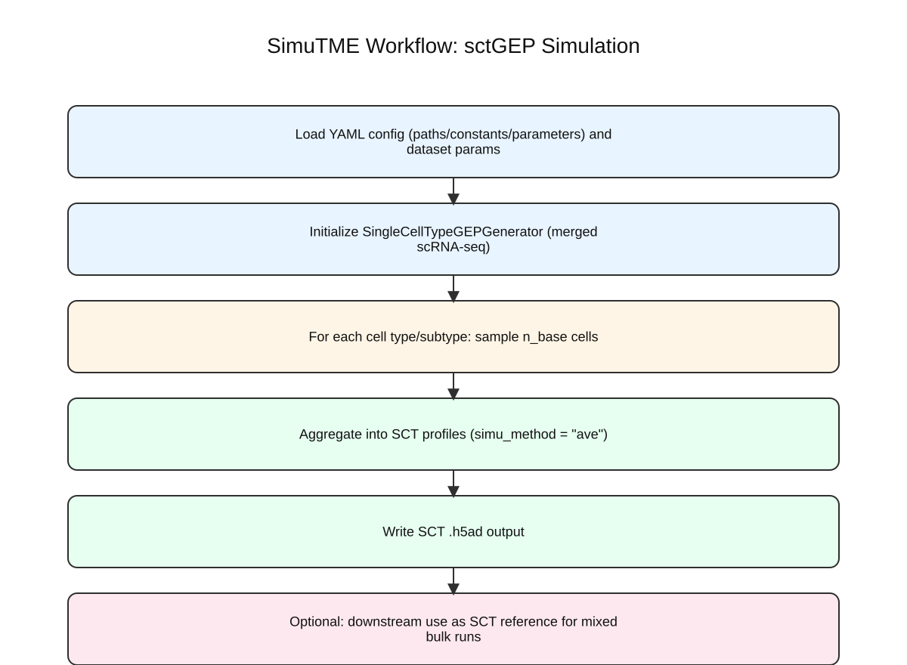

# SCT Workflow

## Goal

The SCT workflow generates single-cell-type gene expression profiles from a
merged scRNA-seq dataset. Each simulated sample represents one cell type or
subtype and is stored in `log2(TPM+1)` format.

This workflow is used to:

- create SCT reference datasets
- provide reference profiles for later Mixed bulk simulation
- optionally produce an imputed SCT reference using a sorted bulk dataset
- optionally measure within-cell-type sample diversity from the generated SCT
  profiles

## High-Level Steps

1. Load the merged scRNA-seq dataset.
2. Restrict to the selected datasets and configured cell types/subtypes.
3. Optionally remove cells with very high zero ratio.
4. Sample cells for each target cell type or subtype.
5. Average the sampled cells into SCT profiles.
6. Save CSV and `.h5ad` outputs.
7. Optionally apply sorted-bulk-guided SCT post-imputation.
8. Optionally run sample-diversity analysis on the saved SCT profiles.

The visual summary is shown below.



## Required Inputs

### Global YAML fields

- `paths.merged_sc_dataset_file_path`
- `paths.simu_bulk_dir`
- `constants.sc_dataset_ids`
- `constants.cell_type2subtypes`
- `constants.output_types`
- `parameters.n_base`

### Dataset-level fields

- `dataset_type: "SCT"`
- `n_samples`
- `sampling_method_gep`

### Common optional dataset-level fields

- `zero_ratio_threshold`
- `cell_type_col`
- `cell_subtype_col`
- `max_cells_per_cell_type`
- `neighbor_sampling_scheme`
- `run_sample_diversity_analysis`
- `sample_diversity_gene_mode`
- `sample_diversity_n_top_genes`
- `sample_diversity_gene_list_path`
- `sample_diversity_distance_metric`
- `sample_diversity_min_samples_per_cell_type`

## Sampling Behavior

`sampling_method_gep` is required for every SCT dataset and must be set
explicitly to either `random` or `n_neighbors`.

### `sampling_method_gep: "random"`

Randomly sample cells from the target class and average them.

### `sampling_method_gep: "n_neighbors"`

Select a seed cell and then use its nearest neighbors within the same class to
construct the SCT profile. This mode is more expensive and may require limiting
the number of cells per class via `max_cells_per_cell_type`.

#### `neighbor_sampling_scheme`

This SCT-only option controls how cells are grouped when
`sampling_method_gep: "n_neighbors"`. Its default is `"single_anchor"`; it
must remain `"single_anchor"` when `sampling_method_gep: "random"`.

- `"single_anchor"`: select one anchor cell and construct the entire SCT
  profile from its nearest neighbors. This preserves the original
  nearest-neighbor sampling behavior.
- `"two_half_anchor"`: construct one SCT profile from two approximately
  half-sized nearest-neighbor groups, each selected from its own anchor cell.
  When cells from multiple source datasets are available, SimuTME preferentially
  selects the second group from a different dataset. It falls back to the same
  dataset when a second source dataset is not feasible.

Use `"two_half_anchor"` when the requested number of SCT GEPs for a cell
type is large relative to the available single cells. Under `"single_anchor"`,
the nearest-neighbor group is determined by the selected anchor; selecting the
same anchor again can therefore reproduce the same SCT profile. By combining
two independently anchored half-groups, `"two_half_anchor"` increases the
number of possible cell combinations and reduces repeated SCT profiles in small
candidate pools. It improves diversity but does not guarantee that all
simulated profiles are unique.

## Main Outputs

For a dataset named `<dataset_name>` and sampling method `<sampling_method_gep>`,
the SCT generator writes files under:

`paths.simu_bulk_dir/generated_sct_dataset_<n_sc_datasets>ds_n_base<n_base>_all_subtypes/`

Main files:

- `cell_fractions_<dataset_name>_gepsamp-<sampling_method_gep>.csv`
- `simu_gep_<dataset_name>_gepsamp-<sampling_method_gep>_sampled_sc_cell_id.csv`
- `simu_gep_<dataset_name>_gepsamp-<sampling_method_gep>_log2cpm1p.csv`
- `simu_gep_<dataset_name>_gepsamp-<sampling_method_gep>_log2cpm1p.h5ad`

## Optional Sample-Diversity Analysis

This workflow is enabled globally or per SCT dataset with:

```yaml
run_sample_diversity_analysis: true
```

It only applies to datasets with:

```yaml
dataset_type: "SCT"
```

### Additional Optional Parameters

- `sample_diversity_gene_mode`
- `sample_diversity_n_top_genes`
- `sample_diversity_gene_list_path`
- `sample_diversity_distance_metric`
- `sample_diversity_min_samples_per_cell_type`

### What The Sample-Diversity Step Does

1. Load the generated SCT `.h5ad`.
2. Read the saved sample-level `log2(TPM+1)` profiles directly.
3. Infer each sample's cell type from the one-hot SCT fraction table in
   `adata.obs`.
4. Analyze each cell type separately.
5. Select genes according to `sample_diversity_gene_mode`:
   - `all`
   - `hvg` (uses a shared HVG ranking derived from `paths.merged_sc_dataset_file_path` and caches the full gene-variance table next to that `.h5ad`)
   - `provided_gene_list`
6. Compute the log-space median centroid `mGEP_log` for each cell type.
7. Compute sample-to-centroid distances using:
   - `cosine` (default)
   - `l2`
8. Save per-sample distances, per-cell-type summaries, the `mGEP_log` table,
   and figures.

### Outputs From The Sample-Diversity Step

Outputs are saved under:

`<output_parent>/<dataset_name>/sample_diversity/`

where `<output_parent>` is the parent directory of the SCT `.h5ad` used for the
analysis.

Main files:

- `config_used.yaml`
- `per_cell_type_distance.csv`
- `per_cell_type_summary.csv`
- `per_cell_type_mGEP_log.csv`
- `figures/distance_boxplot_by_cell_type.png`
- `figures/distance_boxplot_by_cell_type.pdf`
- `figures/<cell_type>_distance_distribution.png`
- `figures/<cell_type>_distance_distribution.pdf`

## Optional Sorted-Bulk-Guided SCT Post-Imputation

This workflow is enabled at the dataset level with:

```yaml
apply_sorted_bulk_imputation: true
```

It only applies to datasets with:

```yaml
dataset_type: "SCT"
```

### Additional Required Inputs

- `paths.sorted_bulk_expr_file_path`
- `paths.sorted_bulk_annot_file_path`
- `paths.sorted_bulk_cell_type_mapping_file_path`

### Additional Optional Global Parameters

- `parameters.sorted_bulk_cell_type_col`
- `parameters.sorted_bulk_imputation_eps`
- `parameters.sorted_bulk_imputation_seed`
- `parameters.sorted_bulk_imputation_batch_size`
- `parameters.sorted_bulk_imputation_boxplot_sample_size`
- `parameters.sorted_bulk_imputation_bulk_weight`
- `parameters.sorted_bulk_imputation_y_frac_threshold`
- `parameters.sorted_bulk_imputation_output_suffix`

### What The Post-Imputation Step Does

1. Load the newly generated SCT `.h5ad`.
2. Load and align the sorted bulk expression matrix to the SCT gene list.
3. Map each SCT cell type to a sorted bulk reference cell type.
4. For each SCT sample, find the Euclidean-nearest sorted bulk sample in TPM
   space within the mapped reference class.
5. Branch by the `included` flag in the mapping file:
   - `included == 1`: replace the SCT profile with the weighted TPM-space
     blend `(1 - bulk_weight) * SCT + bulk_weight * bulk`, controlled by
     `sorted_bulk_imputation_bulk_weight`
   - `included == 0`: impute genes that are near zero in the SCT sample using
     the chosen sorted bulk sample
6. For `included == 0`, limit the newly added expression by
   `sorted_bulk_imputation_y_frac_threshold`.
7. Save an imputed SCT `.h5ad`.
8. Save diagnostics such as pre/post sparsity summaries and `y_fraction`
   summaries.

### Outputs From The Post-Imputation Step

The imputed SCT `.h5ad` is saved beside the original SCT `.h5ad` using:

`<original_stem><sorted_bulk_imputation_output_suffix>.h5ad`

Diagnostic outputs are saved under:

`<generated_sct_parent>/<dataset_name>/`

Examples of diagnostic files:

- `<dataset_name>_pre_imputation_sct_sparsity_per_cell.csv`
- `<dataset_name>_pre_imputation_sct_sparsity_summary.csv`
- `<dataset_name>_pre_imputation_sct_sparsity_boxplot.png`
- `<dataset_name>_post_imputation_sct_sparsity_per_cell.csv`
- `<dataset_name>_post_imputation_sct_sparsity_summary.csv`
- `<dataset_name>_post_imputation_sct_sparsity_boxplot.png`
- `<dataset_name>_sct_added_expression_y_per_cell.csv`
- `<dataset_name>_sct_added_expression_y_summary.csv`
- `<dataset_name>_sct_added_expression_y_fraction_before_adjustment_boxplot.png`
- `<dataset_name>_sct_added_expression_y_fraction_after_adjustment_boxplot.png`

The `y` diagnostics remain meaningful for rows processed with `included == 0`.
Rows processed with `included == 1` use direct TPM averaging and therefore
contribute zero in the `y` output tables.

## Handoff To Mixed Simulation

SCT generation no longer changes a global Mixed reference path implicitly.
Instead, SimuTME records the generated SCT outputs for each SCT dataset:

- the original SCT `.h5ad`
- the `_sorted_bulk_imputed` SCT `.h5ad`, when post-imputation is enabled

Later Mixed datasets must opt into one of these outputs explicitly through
their `sct_reference` block.

If a Mixed dataset references:

```yaml
sct_reference:
  source_type: "generated_dataset"
  dataset_name: "<sct_dataset_name>"
```

then the SCT dataset should appear earlier than that Mixed dataset in the YAML
order.
